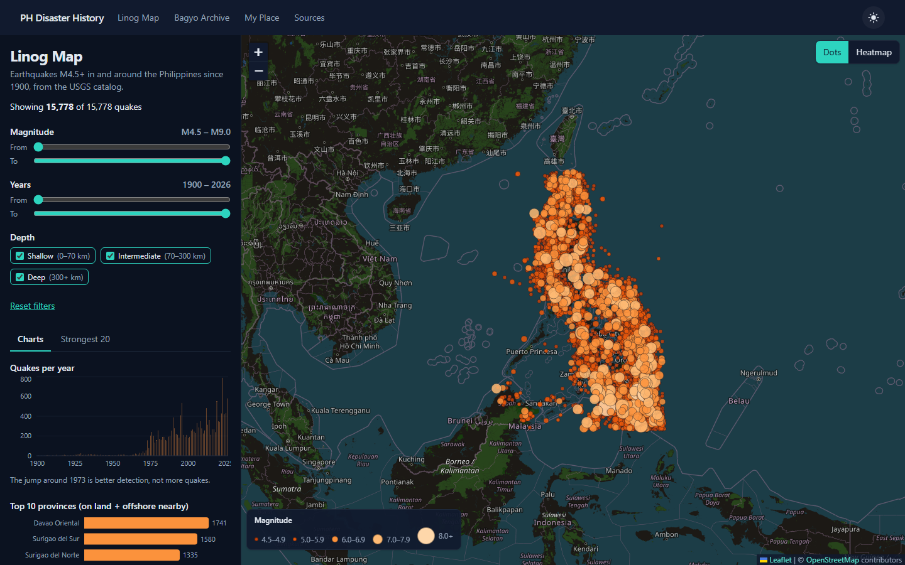
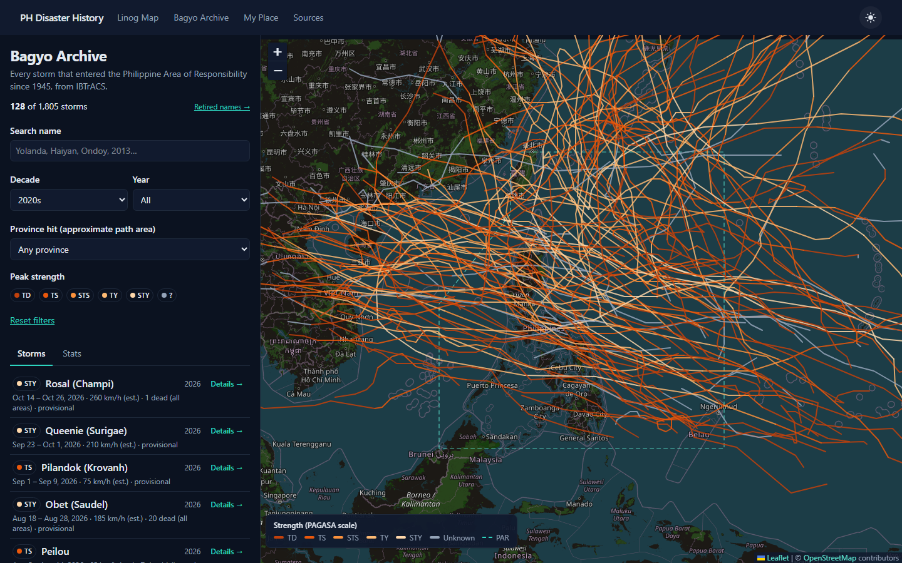
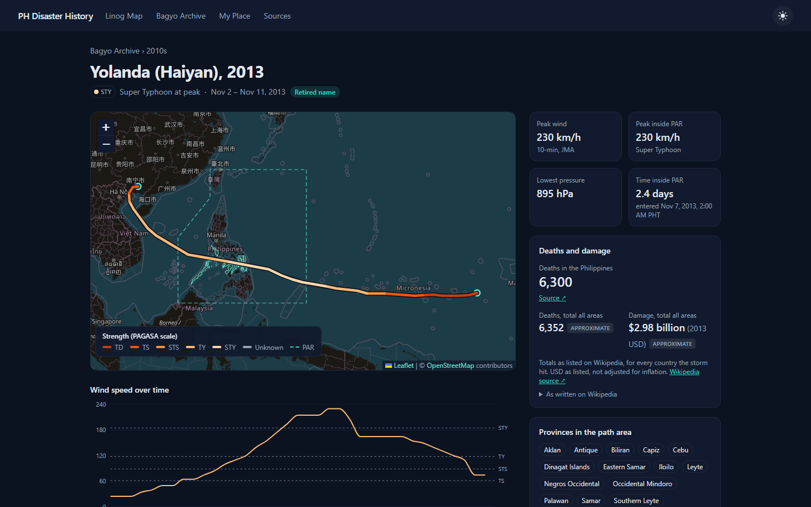
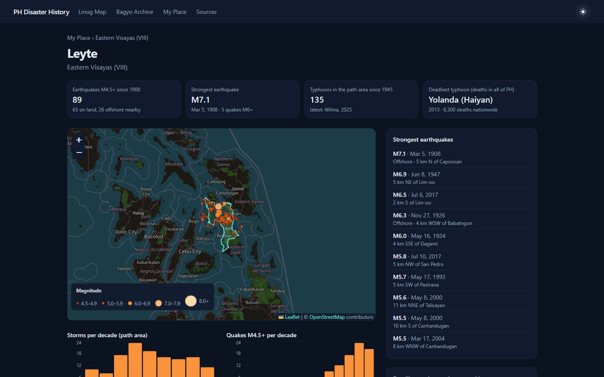

# PH Disaster History: Linog Map + Bagyo Archive

A free, fully static website that maps where strong earthquakes hit the Philippines most often, and the history of every typhoon that entered the Philippine Area of Responsibility (PAR) since 1945, with its PAGASA local name, track, strength, deaths and damage.

*Linog* = earthquake, *bagyo* = typhoon.


| Linog Map | Bagyo Archive |
| --- | --- |
|  |  |

| Storm page (Yolanda / Haiyan, 2013) | My Place (Leyte) |
| --- | --- |
|  |  |

## What's in it

- **Linog Map** (`/linog`): 15,778 earthquakes of M4.5+ since 1900 on one map. Filter by magnitude, year and depth; switch between dots and a heatmap; charts (per year, top provinces, by magnitude) and the 20 strongest quakes, which fly the map to the quake when clicked.
- **Bagyo Archive** (`/bagyo`): 1,805 storms. Search by PAGASA or international name, filter by decade, year, strength and province; tracks drawn on the map, colored by strength.
- **Storm pages** (`/bagyo/[id]`): one page per storm with both names, the full track, wind speed over time, peak and in-PAR strength, deaths and damage with Wikipedia sources, and the provinces in its approximate path area.
- **Retired names** (`/bagyo/retired`): the 92 local names PAGASA retired after deadly storms.
- **My Place** (`/lugar`, `/lugar/[province]`): pick one of 84 provinces (82 provinces, Metro Manila, BARMM Special Geographic Area) and see its earthquakes and the typhoons whose path passed over or near it.
- **Sources** (`/sources`): every data source, picture credit and method.
- Works on phones (filters in a bottom sheet), dark and light mode, all times in PH time.

## Data sources

| Data | Source | Licence |
| --- | --- | --- |
| Earthquakes | [USGS Earthquake Catalog API](https://earthquake.usgs.gov/fdsnws/event/1/) | Public domain |
| Typhoon tracks, winds | [IBTrACS v04r01](https://www.ncei.noaa.gov/products/international-best-track-archive), NOAA NCEI | Free to use, cite |
| PAGASA names, deaths, damage | [Wikipedia](https://en.wikipedia.org/) via the MediaWiki API | CC BY-SA 4.0 |
| Province boundaries | [faeldon/philippines-json-maps](https://github.com/faeldon/philippines-json-maps) (PSGC) | MIT |
| Map tiles | [OpenStreetMap](https://www.openstreetmap.org/copyright) | ODbL |
| Landing page pictures | Wikimedia Commons (NASA, NOAA, Chiba University, PHIVOLCS, Joelaldor, Lawrence Ruiz) | Public domain, CC0, CC BY-SA 4.0 |

Official sources for warnings: [PAGASA](https://www.pagasa.dost.gov.ph/), [PHIVOLCS](https://www.phivolcs.dost.gov.ph/), [NDRRMC](https://ndrrmc.gov.ph/).

## Tech stack

Next.js 16 (App Router, static export) · TypeScript · Tailwind CSS 4 · Leaflet + react-leaflet + OpenStreetMap · leaflet.heat · Recharts · data scripts in TypeScript (tsx) with @turf/turf and mapshaper. No backend, no database, no API keys. Cost: ₱0.

## Run it

```bash
npm install
npm run dev
```

Open http://localhost:3000.

Production build (writes the static site to `out/`, about 1,900 pages, ~40 s):

```bash
npm run build
npm run preview
```

## Refresh the data

The generated JSON in `public/data/` is committed, so the site builds without running any script. To rebuild it from the sources:

```bash
npm run data:all
```

That runs, in order:

1. `npm run data:provinces`: province boundaries → `public/data/provinces.json`, `provinces-index.json`, `ph-outline.json`
2. `npm run data:quakes`: USGS, one request per year → `public/data/quakes.json`, `quakes-summary.json` (~2 min the first time)
3. `npm run data:typhoons`: IBTrACS CSV (115 MB) → Wikipedia (names, damage, retired names, ~1 min) → affected provinces → `public/data/typhoons/`

Downloads are cached in `data/raw/` (gitignored); add `--force` to a script to download again. Parser tests: `npm run test:scripts`.

### Manual fixes

Never edit the generated CSVs in `data/` (`pagasa-names.csv`, `damage.csv`, `retired-names.csv`); rerunning the scripts overwrites them. Put corrections in **`data/overrides.csv`**, which is applied last and always wins:

```
sid,field,value,note
2020313N08135,ph_deaths,98,"NDRRMC figure from the Vamco article"
2020313N08135,ph_source_url,https://en.wikipedia.org/wiki/Typhoon_Vamco,
```

Fields: `local_name`, `deaths`, `damage_usd`, `damage_year`, `needs_review`, `source_url`, `wiki_url`, `ph_deaths`, `ph_source_url`. The storm `sid` is the IBTrACS id in the storm page's URL. Then run `npx tsx scripts/build-typhoons.ts`.

## How the numbers are made

- **PAR:** a storm counts when its IBTrACS track enters the real PAR polygon, or when PAGASA named it (track just outside the line).
- **Strength:** PAGASA scale on 10-minute winds (JMA). If JMA has no wind, the JTWC 1-minute wind × 0.88 is used and marked "estimated".
- **Local names:** matched from Wikipedia season pages (1990 on) by international name, then JTWC number, then dates, and checked against that season's official PAGASA name list. Retired storms before 1990 take their name from the retired list.
- **Deaths and damage:** Wikipedia infobox totals for all countries, labeled "Total, all areas". The deadliest list uses only checked PH-only death counts (`ph_deaths` in `overrides.csv`).
- **Approximate path area:** provinces within about 50 km of the track. Not an official affected-areas list.
- **Quake provinces:** point in province; at sea within 100 km = "offshore, near"; otherwise "Outside PH".

## Project structure

```
scripts/            data pipeline (fetch-*, build-*, compute-affected) + lib/ (parsers, tests)
data/               generated CSVs + overrides.csv (manual) · raw/ downloads (gitignored)
public/data/        generated JSON the site loads (committed)
public/images/      landing page pictures + credits.json
src/app/            pages: /, /linog, /bagyo, /bagyo/[id], /bagyo/retired, /lugar, /lugar/[province], /sources
src/components/     map layers, filters, charts, page sections
src/lib/            types, loaders, scales, formatters
```

See `PLAN.md` for the build plan and `PROGRESS.md` for the step-by-step log.

## Limitations

- USGS magnitudes can differ from PHIVOLCS; the catalog before 1973 mostly lists bigger quakes.
- Storms before 1945 are left out (IBTrACS has no wind data for them); some 1945–1980s storms have no wind data and show "Unknown strength".
- PAGASA-only depressions that IBTrACS doesn't track (e.g. TD Winnie 2004) have no storm page.
- Wikipedia figures can change; rerun `npm run data:typhoons` to refresh them.
